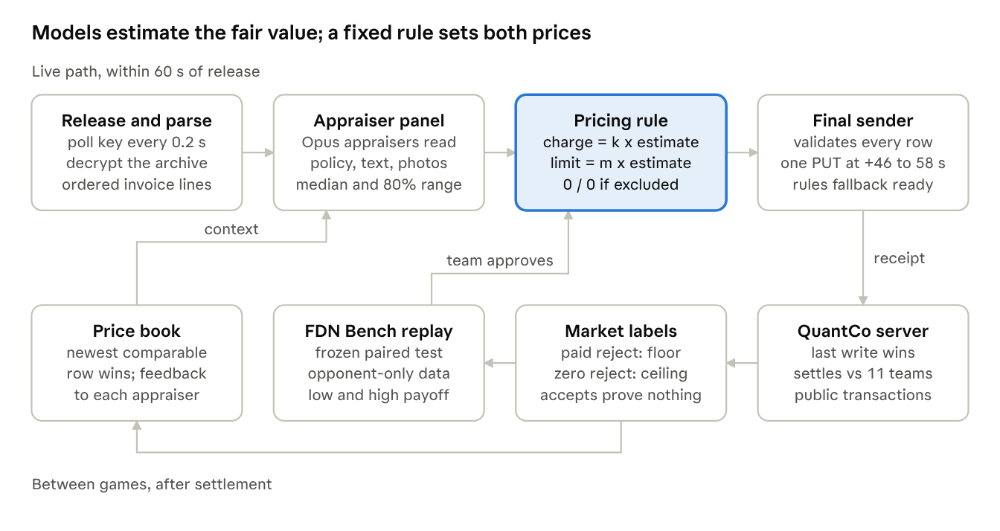
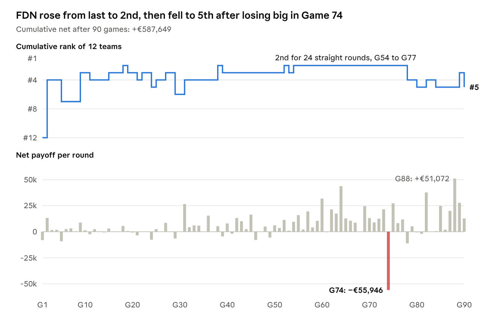

# FDN technical report for QuantCo's Claim to Fame

*The one-page write-up with final standings is [WRITEUP.pdf](../WRITEUP.pdf). This longer report was written at Game 90, so its standings and results figures are as of Game 90.*

Team FDN · START Hack Munich 2026 · 22 November 2026

## Summary

**After Game 90 of 100, FDN is 5th of 12 teams with €587,649 cumulative net payoff.** The figures come from the official leaderboard at 09:49 CET on 22 November. FDN held 2nd place for 24 straight games, from Game 54 to Game 77.

FDN prices each invoice line in two steps. Language-model appraisers read the policy, the damage description, the invoice and the photos, and estimate the hidden fair value of each line. A fitted pricing rule then turns those estimates into a charge and an acceptance limit. A sender checks the full payload and submits it inside the 60-second window.

Between games, FDN Bench replays a proposed rule change against frozen appraisals and settled market outcomes. A teammate approves each change before it goes live. The bench stopped the most obvious fix of the weekend, a price cap after Game 53, because it lost money on 23 earlier games.

| Metric through Game 90 | Value |
| --- | ---: |
| Cumulative net payoff | €587,649 |
| Income and insurer costs | €2,425,564 and €1,837,915 |
| Games won outright | 7 of 90 |
| Games finished in the top 3 | 34 of 90 |
| Correct review decisions | 83.8%, 2nd of 12 teams |
| FDN charges accepted by opponents | 48.5%, against 34.8% to 37.5% for the top four |
| Net payoff, Games 1 to 29 | €18,369 |
| Net payoff, Games 30 to 90 | €569,280 |

## The game and the optimal limit

**Each game is one repair invoice with blank prices, and every team prices every line twice within 60 seconds.** QuantCo's Claim to Fame ran 100 games, one every 13 minutes 20 seconds, from Saturday 14:00 to Sunday 12:00 CET. Each case has a policy, a damage description, photos and an invoice that shows quantities and units but no prices.

Each line has a secret fair value t. It is the gross line total, including 19% VAT, that the game's claims expert accepts. A line that the policy does not cover, or that the damage did not cause, has t = 0. Each team submits a charge a and an acceptance limit b for every line. Every pair of teams then trades in both directions. Our charge meets their limit, and their charge meets our limit.

| Insurer decision | Fair charge, a ≤ t | Inflated charge, a > t |
| --- | ---: | ---: |
| Accept, a ≤ b | a | min(a, c), where the cap c is at least 4t |
| Reject, a > b | 1.5a | 0 |

**The limit has a closed-form answer.** As the reviewer, we pay a if we accept a bill. If we reject it, we pay 1.5a when the bill was fair and nothing when it was inflated. Accepting costs less exactly when

```math
a \le 1.5\,a \cdot P(t \ge a) \iff P(t \ge a) \ge \tfrac{2}{3}
```

So we should accept every charge below the 33rd percentile of our belief about t and reject every charge above it. The limit b is that percentile. This assumes our belief is calibrated and that the size of the incoming charge tells us nothing more about t.

**The charge has no closed form, because it depends on the opponents' limits.** One euro above t loses the whole line, while one euro below t loses one euro. A charge just under t earns a when an opponent accepts it and 1.5a when an opponent wrongly rejects it. We set the charge as a multiple of the appraisers' estimate and fitted the multiple on settled games.

The window closes 60 seconds after the server releases the decryption key. The server keeps only the last write, and a missing line defaults to a charge and limit of 0. A limit of 0 rejects every incoming bill, so a missing line costs 1.5 times every fair charge against it. After each game, the public leaderboard publishes every team's settled trades. Those trades were our only feedback. The jury weights final rank at 70% and the write-up and pitch at 30%.

## System design

**Language models read the case, and plain code sets the prices, checks the payload and submits it.** The top row of the diagram runs inside each 60-second window. The bottom row runs between games. It turns settled trades into labels, appraiser context and tested rule changes.



The team ran two appraiser designs.

| Design | Built by | Memory between games | Context for each case |
| --- | --- | --- | --- |
| Persistent panel | Daniil | Claude Opus 5.5 and Fable 5.2 sessions keep their full history | Each session sees its own past estimates next to the settled floor and ceiling for each line |
| Fresh panel | Ruben | None. Nine new appraisers start on every case | Retrieved precedent cases, the market price book and written pricing rules |

A fourth session, the decider, saw the persistent panel's answers and each appraiser's track record. It set the submitted prices in Games 13 to 18 and ran for the record only after that. Daniil stopped the persistent panel on purpose before Game 66. [TRAINING.md](TRAINING.md) explains how its sessions were trained on settled games.

Every appraiser returns JSON for each line with four fields: covered, related, a median fair value, and a low and high estimate. Photos go in as images, downscaled when a file is over 5 MB. The prompt marks case files as data, not instructions, so text inside a claim cannot change the appraiser's task.

## From estimates to prices

**Appraisers never choose a price. They predict t, and a fitted multiple of their estimates sets both the charge and the limit.**

### How the pricing rule changed

| Period | Charge | Limit | Reason for the change |
| --- | --- | --- | --- |
| Opening baseline, commit `27317fa` | 25th percentile of 100 sampled fair values | 33rd percentile | The limit result above, with a cautious charge |
| Persistent panel, from Game 12 | Median of the appraisers' low estimates | The charge plus one third of the gap to the median high estimate | Appraisers defined their low estimate as a value t is at least, so it became the charge |
| Pooled formula over six sources | 0.92, 0.84 or 1.16 times the median, by how far the sources agree | 1.04 times the lowest estimate | Fitted on settled floors and ceilings and audited below |
| Fresh panel, from Game 55 | 0.90 times the average of the panels' fair values, down from 0.93 | 1.00 times that average, up from 0.91 to 0.96 | An agent profiled recent settlements, and Ruben approved the change |

In the pooled formula, sources agree when their coefficient of variation is below 0.15 and partly agree when it is below 0.40.

A line gets a price only when most appraisers say it is both covered and related. Every other line gets a charge and limit of 0. A guard stops the rule from charging 0 when any appraiser gave a positive low estimate.

### The appraiser prompt

The final appraiser prompt, version 5, gives the appraiser one job: predict t as this market reveals it. It asks for a median and calibrated 10th and 90th percentiles, with no safety margin. The pricing rule adds the margin. The prompt tells the appraiser to price like a German master tradesperson and cost estimator:

- Multiply quantity by unit price, and never price one unit when the invoice bills several.
- Price labour as hours times the role's gross hourly rate, taken from the newest matching row of the price book.
- Price equipment as days times the daily rate.
- Price replacement goods like for like, at the current German street price.
- Apply a contract cap only to the line it names.

Each case message includes a market price book built from earlier settlements. Its main rule is that the newest comparable row wins. Cases came in families, and rates changed between families rather than along a trend, so an average of old rows priced worse than the latest match. Covered and related are separate flags and never change the price estimate. The pricing rule, not the appraiser, decides when a line is priced at 0.

### Labels from settled trades

An accepted bill proves nothing about t, so the labels come only from rejected bills.

- A rejected bill that the insurer paid proves the charge was fair. The floor is the largest such charge, which is the payment divided by 1.5.
- A rejected bill that paid nothing proves the charge was inflated. The ceiling is the smallest such charge.

Each labelled line then satisfies floor ≤ t < ceiling. These intervals feed the price book and the persistent panel's feedback. A line with no rejected bill gets no label.

## Delivery and reliability

**Every game we audited has a complete server receipt before the close, and the public results point to two missed games out of 90.** The server keeps only the last write, so the order of writes mattered as much as speed.

### The 60-second sequence

1. At release, the sender polls for the game key every 0.2 seconds, decrypts the staged archive and parses the invoice into ordered lines.
2. The appraisers run in parallel with a hard timeout of 30 to 40 seconds each. The sender drops any late or malformed answer.
3. Meanwhile, the Mac fallback builds a complete rules-based payload, so a valid submission exists even if every model is late.
4. Between 46 and 58 seconds after release, the sender combines the answers that arrived, checks that every line has a finite, non-negative price in invoice order, and sends one request.
5. After the close, the sender saves the receipt, elapsed time and row count. We then match the acknowledged rows against the public settlement.

### Receipts for audited games

| Game | Prices ready, seconds after release | Complete receipt, seconds after release | Lines acknowledged |
| --- | ---: | ---: | ---: |
| 56 | 24.01 | 58.252 | 25 of 25 |
| 55 | 13.93 | 58.147 | 10 of 10 |
| 53 | 19.94 | 58.10 | 13 of 13 |

In Game 53, all 10 FDN charges visible in the public settlement match the submitted payload. The Mac fallback alone has 38 receipt-checked writes through Game 43. A later team write may have replaced some of them, so that count does not measure team-wide delivery.

### Incidents

| Game | What happened | Response |
| --- | --- | --- |
| 22 and 30 | FDN's net is exactly zero while most teams traded, which points to no settled FDN write | Not yet reconciled. Game 35 is unclear, and Games 37 and 83 were zero for every team |
| 13 to 15 | Two FDN senders were live. The persistent panel sent at 50 seconds and overwrote the Mac fallback's writes at 18 to 27 seconds | The team fixed one sending order, with the planned final sender last |
| 1 and 2 | A safety-net script submitted a charge of 0 and a limit of 1,000,000 on every line, so FDN accepted every bill | Disabled from Game 3, because accepting every bill pays every inflated charge |

A standby worker on Coolify was ready to replace a failed sender. The persistent sessions compacted their context only when the next release was more than 120 seconds away, or 150 seconds for the decider, so compaction never ran during a game.

### Resource use

FDN ran up to nine model appraisers per case, each stopped after 30 to 40 seconds. Replays reuse saved appraisals, so testing a rule on 23 past games makes no new model calls. The pricing rule, the payload checks and the replay scorer are plain code. We did not log token spend per game, so we cannot report a cost per game.

## Testing changes before they go live

**We scored each proposed rule in a paired replay on frozen appraisals, and the replay stopped two of the three rules we tested.** FDN Bench rebuilds each settled game from the public trades. Our exact replay of Games 1 to 19 reproduced all 228 official FDN results, so we trusted the scorer before we used it.

### Replay protocol

- Freeze both rules, baseline and candidate, on the same saved appraisals before scoring any payoff.
- Price each game using only earlier games, and score every game in the window.
- In clean comparisons, use only trades between other teams. FDN's own trades, receipts and scores stay out, so a rule cannot learn from its own outcome.
- Report a low and a high payoff. The gap covers what public data cannot settle: the hidden fair value, the cap, and opponents' decisions on lines FDN did not trade.

### Three rules we tested

| Game | Proposed rule | Paired result | Decision |
| --- | --- | --- | --- |
| 59 | When all nine appraisers agree a line is covered and related, raise the charge by up to 5%, capped at their lowest estimate | Games 56 to 61: −€2,213 to +€1,205. Games 30 to 61, 32 games: +€1,263 to +€13,884 | Not shipped. The newest games and a check on Games 44 to 61 both include zero |
| 55 | Cut the charge multiple from 0.93 to 0.90 and raise the limit multiple to 1.00 | Both changes together: −€2,237 to +€2,094. The limit change alone: +€1,991 to +€2,086 | Approved by Ruben and shipped. Game 55 earned €15,980, 2nd of 12, but one game does not show the counterfactual |
| 53 | All 11 opponents rejected our €378.20 drying charge, so the line earned €0. A matching job from Game 36 had dropped out of the appraisers' context. The proposal capped prices at the earlier comparable job | Games 30 to 52, 23 games. Capping only the limit changed 5 lines and lost €566.65. Capping only the charge lost €2,621 to €3,078. Capping both lost €3,188 to €3,645 | Rejected. We fixed retrieval instead, because a similar line can still cover different work |

### Overfitting audit of the pooled formula

A research agent audited the pooled formula on Games 1 to 29. It used walk-forward fits, leave-one-game-out fits, a bootstrap with 200 resamples, and a hold-out that fit on Games 1 to 24 and tested on Games 25 to 29.

- **The structure held up.** A tiered multiple of the median for the charge, with the limit on the lowest estimate, ranked first on every out-of-sample measure. Its walk-forward bootstrap median was €138.7k, against €85.7k for a plain median rule. Its 5th percentile beat the median of every rival rule.
- **The limit on the lowest estimate mattered most.** Every variant that set the limit from the median or the mean had a 5th-percentile worst case between −€65k and −€120k, because it accepted inflated bills.
- **One parameter was overfit.** The agree multiple of 0.92 sat just below five lines whose proven floor was 0.93 to 0.96 times the median. A multiple of 0.94 or more loses those lines entirely. If our estimates drifted up 2%, the worst case fell by €22k. The audit recommended 0.90, 0.84 and 1.12 with a limit of 1.02 times the lowest estimate, giving up €5.4k to €7.4k in sample for less exposure to that drift.

The audit included FDN's own trades and covers only Games 1 to 29. It tests the shape of the formula, not its payoff in later games. The Game 55 change set the limit at the panels' average, which the audit warns against. That change used a different panel, and its limit part alone was positive in paired replay, so the two results conflict and we have not resolved them.

## Results

**FDN rose from last place after Game 1 to 2nd by Game 54, then fell to 5th after losing €55,946 in Game 74.** Games 30 to 90 averaged €9,332 net per game, against €633 in Games 1 to 29, when the panel and the pricing rule were still being fitted.



*Source: QuantCo public leaderboard API, Games 1 to 90, fetched at 09:47 CET on 22 November.*

### Standings after Game 90

| Rank | Team | Net payoff | Correct review decisions | Own charges accepted |
| ---: | --- | ---: | ---: | ---: |
| 1 | Kiebler Software Solutions | €854,075 | 86.2% | 35.1% |
| 2 | chineseModels | €717,280 | 83.0% | 35.0% |
| 3 | Humble Legends | €609,566 | 80.5% | 37.5% |
| 4 | TRINNERS4WINNERS | €599,278 | 80.9% | 34.8% |
| **5** | **FDN** | **€587,649** | **83.8%** | **48.5%** |
| 6 | GemischtesHack | €493,457 | 78.2% | 42.0% |

FDN is €11,629 behind 4th and €21,917 behind 3rd, with ten games left.

**Most of the gap to the leader is income, not review mistakes.** FDN trails Kiebler Software Solutions by €266,426. Lower income accounts for €221,908 of that, and higher insurer costs for €44,518. FDN's review accuracy is 2nd in the field, but opponents accept 48.5% of FDN charges, against 34.8% to 37.5% for each of the top four. An accepted charge sits below the opponent's limit, so FDN may charge further below fair value than the leaders and give up margin on lines it would win anyway.

### Example: one line in Game 55

Three appraisal panels valued a painting line at €700, €680 and €650, an average of €676.67. The rule charged 0.90 times that average, €609, and set the limit at the average itself. Prices were ready 13.93 seconds after release, and the server acknowledged all 10 lines at 58.147 seconds. FDN earned €15,980 in Game 55, 2nd of 12.

## What went wrong and what we cannot claim

**FDN's worst game, Game 74, lost €55,946, and FDN fell from 2nd to 4th four games later.** Over the last 25 games FDN made €259,640, 6th of 12 teams, while the leader made €481,574. Without Game 74, FDN would still trail the top five teams over those 25 games.

### Failures

- **Game 74 lost €55,946.** FDN finished 9th in that game. The next-worst game, Game 78, lost €11,098. FDN has not been above 3rd since Game 78, and we have not yet found the line-level cause of Game 74.
- **One low appraisal costs twice.** In Game 56 a tiling line got a charge of €598.20 and a limit of €664.67. Settlement proved it was worth at least €876.72. We lost income on our own bill and rejected four fair incoming bills at 1.5 times their charge. Wrongful rejections cost €19,960 in that game, €6,653 of it the extra half charge.
- **The appraisers lost a key precedent in Game 53.** The comparable job that would have priced the drying line had dropped out of their recent-case window.
- **Two FDN senders overwrote each other in Games 13 to 15.** Only receipts and timestamps showed which write the server settled.
- **The first safety net accepted every bill.** It paid every inflated charge in Games 1 and 2, and FDN finished Game 1 last at −€8,022.

### What we would keep

- Keep appraisal and pricing separate. Models read policies, descriptions and photos well, and a fixed rule turns a range into a price under a known payoff.
- Label outcomes only by what settlement proves. A paid rejection gives a floor, an unpaid rejection gives a ceiling, and an acceptance gives nothing.
- Test a fix on frozen inputs before shipping it. The most obvious fix of the weekend, the Game 53 price cap, lost money in replay.

### What we cannot claim

- We cannot attribute the ranking to any one part of the system. Claims, opponents and our rules all changed during the tournament, and no live controlled test isolates the feedback loop or persistent memory.
- We have not reconciled delivery for all 90 games. Audited games have complete receipts, and the public results point to two missed games.
- We have no cost figure, because we did not log token spend.
- We tested rules on the same past games many times, so the replays may overfit those games.

## Next steps

**With another day, we would run a prospective trial instead of more tuning on past games.**

1. Fix retrieval first. Pin the newest comparable job for each trade and role in the price book, so it cannot drop out of context as it did in Game 53.
2. Raise charges where opponents accept FDN bills far more often than the leaders' bills. Income explains €221,908 of the €266,426 gap to the leader.
3. Run a same-case trial with three arms: the current panel, the panel with better retrieval, and a rules-only control. Freeze all arms before release and log model cost for each arm.
4. Lower the agree multiple to 0.90, as the audit recommended.
5. Write the Game 74 postmortem and cap how much any single line can lose in one game.
6. Reconcile every game to a settled FDN write and report delivery and latency for all 100 games.

*Standings are as of Game 90, at 09:49 CET on 22 November. Final Game 100 figures will replace them once settled. Source: [official leaderboard](https://c2f.public.quantco.cloud/leaderboard/).*
